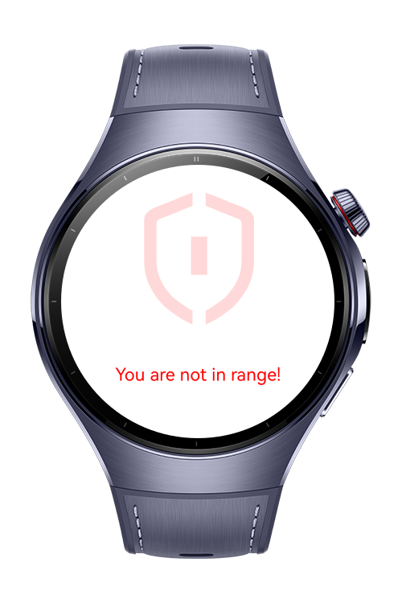
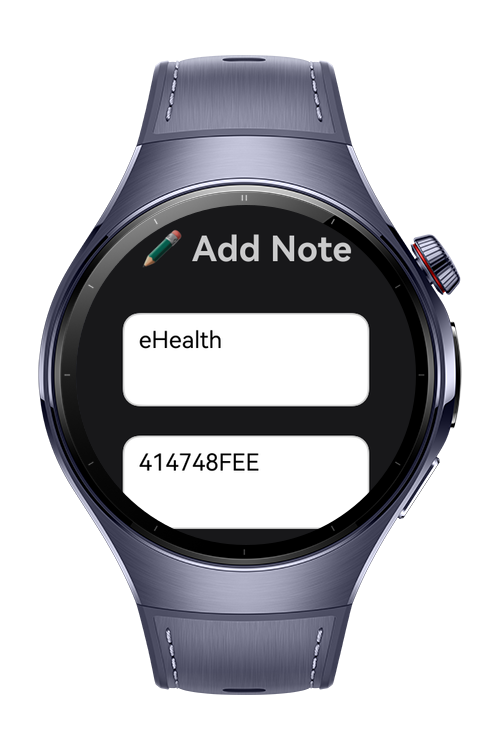
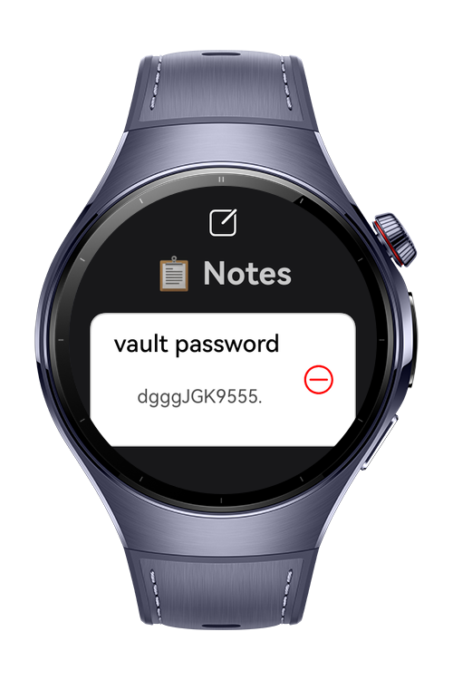
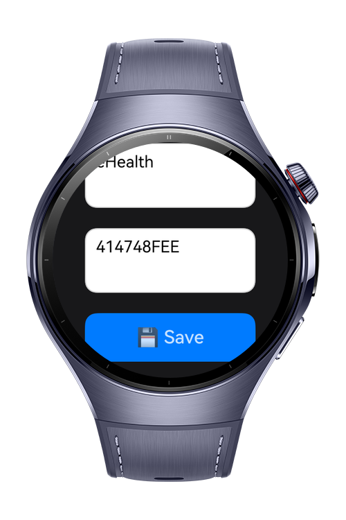

> **Note:** To access all shared projects, get information about environment setup, and view other guides, please visit [Explore-In-HMOS-Wearable Index](https://github.com/Explore-In-HMOS-Wearable/hmos-index).

# Location Based Secure Vault

Secure Notes Dashboard is a HarmonyOS NEXT application that allows users to securely store and access personal notes. Notes are encrypted and stored via **AssetStoreKit**, and can only be viewed within a defined geofence using **LocationKit**. This ensures that sensitive data remains protected and accessible only in permitted locations.

# Preview

<div>
  
  
  
   
</div>

# Use Cases

- **Secure Note Storage**: Notes are saved in encrypted form using AssetStoreKit with password-based or key-based access.
- **Location-Based Access**: Users can only access their notes if they are within a defined radius (e.g., 10 m) of an authorized location.
- **Editor Button**: Quickly add new notes via the editor button in the dashboard.
- **Responsive & Scrollable UI**: Clean card-style design optimized for HarmonyOS devices with smooth scrolling.
- **Delete Notes**: Remove individual notes securely without leaving traces in memory.

# Tech Stack

- **Language**: ArkTS (Ark TypeScript)
- **UI Framework**: ArkUI Declarative Framework
- **OS**: HarmonyOS NEXT (API 18)
- **Architecture**: MVVM (Model-View-ViewModel)
- **Libraries**:
    - `@kit.LocationKit`
    - `@kit.AssetStoreKit`
    - `@kit.AbilityKit`
    - `@kit.ArkUI`
    - `@kit.PerformanceAnalysisKit`
    - `@kit.BasicServicesKit`
    - `@kit.CoreFileKit`

# Directory Structure

├── core
│   ├── base
│   │     └── BaseModel
│   │     └── DurationModel
│   ├── logger
│   │     └── LogManager
│   ├── navigation
│   │     └── NavigationManager
│   ├── permission
│   │     └── PermissionManager
│   ├── storage
│   │     └── AssetStoreManager
├── feature
│   ├── dashboard
│   │     └── model
│   │     │     └── DataListModel
│   │     │     └── DataModel
│   │     └── state
│   │     │     └── DashboardState
│   │     │     └── IDashboardState
│   │     └── utils
│   │     │     └── constants
│   │     │            └── CacheConstants
│   │     │            └── NavigationConstants
│   │     └── view
│   │     │     └── DashboardView
│   │     └── viewModel
│   │           └── DashboardViewModel
│   ├── editor
│   │     └── model
│   │     │     └── DataListModel
│   │     │     └── DataModel
│   │     └── constants
│   │     │     └── CacheConstants
│   │     │     └── NavigationConstants
│   │     └── state
│   │     │     └── EditorState
│   │     │     └── IEditorState
│   │     └── view
│   │     │     └── EditorView
│   │     └── viewModel
│   │           └── EditorViewModel
│   ├── vault
│   │     └── model
│   │     │     └── DataListModel
│   │     │     └── DataModel
│   │     └── constants
│   │     │     └── CacheConstants
│   │     │     └── NavigationConstants
│   │     └── state
│   │     │     └── VaultState
│   │     │     └── IVaultState
│   │     └── view
│   │     │     └── VaultView
│   │     └── viewModel
│   │           └── VaultViewModel
│   ├── splash
│   │     └── constants
│   │     │     └── NavigationConstants
│   │     └── state
│   │     │     └── SplashState
│   │     │     └── ISplashState
│   │     └── view
│   │     │     └── SplashView
│   │     └── viewModel
│   │           └── SplashViewModel
│   ├─── pages
│   │   └─── Index.ets
```
# Constraints and Restrictions

- Access to notes is restricted to authorized locations defined by the application.
- Notes cannot be accessed or exported outside the defined geofence.
- Persistent storage is encrypted; no plaintext copies are stored locally.
- Requires user permission for location access.

## Supported Device

- HarmonyOS NEXT Devices (Smartphones or Tablets)
- API Level 18 and above

# LICENSE

Location Based Secure Vault is distributed under the terms of the MIT License.
See the [LICENSE](./LICENSE) for more information.
